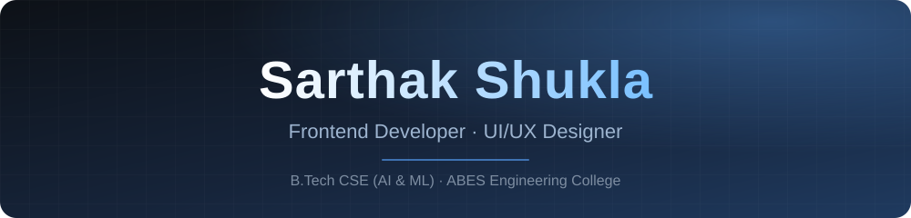

  

&nbsp;&nbsp;&nbsp;

&nbsp;&nbsp;&nbsp;

&nbsp;&nbsp;&nbsp;

&nbsp;&nbsp;&nbsp;

---

## About

I'm a second-year B.Tech student at ABES Engineering College, Ghaziabad (2024–2028), studying CSE with a specialization in AI & ML. Current CGPA: **8.2 / 10**.

I build websites and design the interfaces for them. Outside of code, I run content and graphics for a college tech club and shoot photos at campus events.

Right now I'm working through **DBMS** and building a weather app.

---

## Tech Stack

  

---

## Projects

<table>
<tr>
<td width="50%" valign="top">

### 🌍 EUCATASTROPHE
**Disaster information portal**

Built for the Smart India Hackathon. It collects emergency and disaster-awareness information in one place so people can find it quickly during a crisis.

`HTML` `CSS` `JavaScript`

[View repo →](https://github.com/shuklasarthak333-bit/YOUR_REPO_NAME)

</td>
<td width="50%" valign="top">

### 🌤️ Mausam
**Weather web app** · *in progress*

A weather app with a clean, simple interface. I'm adding more features as I go.

`HTML` `CSS` `JavaScript`

[View repo →](https://github.com/shuklasarthak333-bit/SIH-Mausam)

</td>
</tr>
</table>

---

## Experience

| Role | Where | What I do |
|:--|:--|:--|
| **Content & Graphics Head** | TRISHUL, ABESEC | Started as a volunteer, now lead the club's social media content and visual identity in Canva and Figma |
| **Events Head** | UBA, ABESEC | Coordinate and run the club's events |
| **Graphics Team** | GENERO, ABESEC | Designed event graphics and promotional material for the college cultural fest |
| **Event Photographer** | College events | Cover campus events with a DSLR/mirrorless setup |

---

## Achievements

- **Smart India Hackathon:** qualified the internal round, placed 6th at college level
- **Dialogue Derby:** finalist
- **I3 Summit:** volunteer
- **HCL GUVI:** certification

---

## GitHub Stats

 

